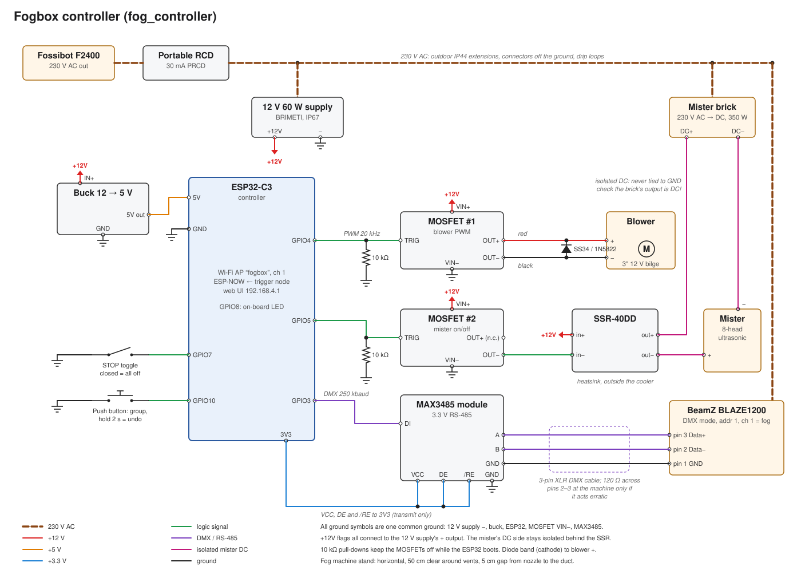

# fog-mister

Firmware for the **fogbox**: a chilled low-fog box hidden along a wooded path
that lays a 10–20 m layer of ground fog for each group of walkers, timed to
start about 90 seconds before they arrive.

A trigger node 100–200 m upstream tells the controller a group is coming. The
controller then runs a fog machine, an ultrasonic mister and a blower on a
timed cycle; the cold fog leaves the box at floor level into a perforated pipe
along the path edge.

```
  trigger node  ──ESP-NOW──►  controller ──DMX──► fog machine ─┐
  (button / PIR)              (ESP32-C3)  ──SSR──► mister     ├─► chiller box ─► manifold pipe
                                          ──PWM──► blower    ─┘
                                 ▲
                         phone: Wi-Fi "fogbox", http://192.168.4.1
```

## Contents

| Path | What it is |
| --- | --- |
| [`fog_controller/`](fog_controller/main.cpp) | Controller sketch: fog machine, mister, blower, web UI, cycle timing |
| [`fog_trigger/`](fog_trigger/main.cpp) | Trigger node sketch: button / PIR → ESP-NOW "group coming" |
| [`docs/fog_controller.svg`](docs/fog_controller.svg) | Controller wiring schematic |
| [`docs/fog_trigger.svg`](docs/fog_trigger.svg) | Trigger node wiring schematic |
| [`docs/gen_schematics.py`](docs/gen_schematics.py) | Generates both schematics |
| [`build.sh`](build.sh) | `arduino-cli` wrapper: build, upload, monitor |

The code of each sketch lives in its `main.cpp`; the `.ino` file is an empty
stub so the Arduino IDE doesn't generate prototypes.

The earlier AT-style BLE config firmware is kept on the
[`esp-at-ble-config`](../../tree/esp-at-ble-config) branch.

## Hardware

Both boards are ESP32-C3 dev boards. A board with an external antenna
connector helps radio range.

**Controller box**

- BeamZ BLAZE1200 fog machine, driven over DMX through a MAX3485 (3.3 V)
  RS-485 module and a cut 3-pin XLR cable
- 8-head ultrasonic mister on its own DC brick, switched by an SSR-40DD
- 3" 12 V bilge blower, PWM through a dual-MOSFET module, SS34/1N5822 flyback
  diode across it
- 12 V 60 W supply, 12 → 5 V buck converter for the ESP32
- STOP toggle switch and a push button
- Mains via a portable 30 mA RCD from a Fossibot F2400

**Trigger node**

- ESP32-C3 on a USB power bank (one that doesn't auto-switch-off at ~80 mA)
- Push button, optional AM312 PIR sensor

### Wiring



| Controller pin | Goes to | Note |
| --- | --- | --- |
| GPIO3 | MAX3485 DI | DMX out; DE and /RE to 3V3 |
| GPIO4 | MOSFET #1 TRIG | Blower PWM, 20 kHz; 10 kΩ TRIG → GND |
| GPIO5 | MOSFET #2 TRIG | Mister via SSR; 10 kΩ TRIG → GND |
| GPIO7 | STOP toggle → GND | Closed = everything off |
| GPIO10 | Push button → GND | Short = group coming, hold 2 s = undo |
| GPIO8 | On-board LED | Active low (SuperMini) |
| 5V / GND | Buck converter | Buck input from the 12 V supply |

The SSR input is driven with a full 12 V (SSR + to +12 V, SSR − to MOSFET #2
OUT−), since 3.3 V is below its 4 V minimum. The mister's DC side is isolated
behind the SSR and never shares the 12 V ground. Check that the mister brick's
output is DC before using the DC-switching SSR-40DD.


| Trigger pin | Goes to | Note |
| --- | --- | --- |
| GPIO3 | Push button → GND | Short = group coming, hold 2 s = undo |
| GPIO4 | PIR output | Optional, set `USE_SENSOR` to `true` |
| GPIO8 | On-board LED | Active low (SuperMini) |
| USB | Power bank | About 80 mA |

## Building and flashing

Requires the Espressif Arduino core 3.3.x.

**arduino-cli**

```sh
./build.sh update                          # install the ESP32 core (once)
./build.sh build                           # build both into dist/<sketch>/
MODULE=fog_controller ./build.sh deploy    # build, upload, serial monitor
MODULE=fog_trigger DEV_PORT=/dev/ttyACM1 ./build.sh deploy
```

`build.sh` keeps its Arduino data in `./.arduino15`; set
`ARDUINO_DIRECTORIES_DATA` to use an existing install instead. Run
`./build.sh help` for all options.

**Arduino IDE 2**

1. Boards Manager → install "esp32 by Espressif Systems" 3.x.
2. Board: "ESP32C3 Dev Module", Tools → USB CDC On Boot: Enabled.
3. Open the `fog_controller` folder and upload; repeat for `fog_trigger` on
   the second board.

### Compile-time options

| Sketch | Define | Default | Meaning |
| --- | --- | --- | --- |
| both | `TX_POWER` | `WIFI_POWER_19_5dBm` | Cheap "SuperMini" boards often reach further at `WIFI_POWER_8_5dBm` |
| both | `ESPNOW_CHANNEL` | `1` | Must match on both boards |
| both | `LED_ACTIVE_LOW` | `1` | Set to `0` for an active-high LED |
| trigger | `USE_SENSOR` | `false` | Use the PIR on GPIO4 |
| trigger | `PIR_LOCKOUT_MS` | `45000` | One group per PIR trigger |
| controller | `AP_SSID` / `AP_PASS` | `fogbox` / `boo-fog-2026` | Web UI access point |

## Using it

Join Wi-Fi **fogbox** (password `boo-fog-2026`) and open
**http://192.168.4.1**. The page shows the phase, queued groups, next arrival,
fog / mister / blower state, warm-up countdown, fallback status, the trigger
node's signal strength and run time totals.

Buttons: *Group coming*, *Undo last group*, *Clear all groups*, *Fog burst
5 s*, *Mister 15 s*, *Blower test* (at a chosen %, 10 s), *End show* and
*STOP / Resume*.

### The cycle

Every trigger means "a group reaches the fog in *walk time* seconds". Groups
are queued, so overlapping cycles just work; the busiest phase of all queued
groups wins.

| Phase | Starts | Fog machine | Mister | Blower |
| --- | --- | --- | --- | --- |
| Build-up | 90 s before arrival | 8 s burst, then 5 s every 20 s | on | 45 % |
| Hold | at arrival, 90 s | 5 s every 30 s | on | 35 % |
| Tail | 30 s | off | on | 30 % |
| Purge | 60 s | off | off | 15 % |
| Idle | until the next group | heater stays hot | off | off |

**Safety limits:** no burst longer than 15 s, at least 10 s between bursts,
no fog during the first 4 minutes after power-on (warm-up), the blower ramps up
at 40 % per second, and STOP (switch or web) cuts everything at once.

**Fallback:** if no trigger arrives within the fallback interval (390 s) after
the last one, the controller starts a cycle itself. After 3 fallback cycles in
a row without a real trigger it stops, so it won't fog an empty wood after
the last group. *End show* disarms it straight away.

### Settings

Stored in NVS on the controller, editable on the web page, kept across
power-off.

| Setting | Default | Set it to |
| --- | --- | --- |
| Walk time | 120 s | A slow walk from the trigger point to the fog stretch |
| Fallback interval | 390 s | Group interval + 30 s (0 = off) |
| Build-up / hold / tail / purge | 90 / 90 / 30 / 60 s | Lengthen build-up if the layer isn't there in time |
| Blower % per phase | 45 / 35 / 30 / 15 | Lowest that still pushes fog to the pipe ends |
| Fog machine enabled | 1 | 0 for mister-only mode before dusk |

On the fog machine: DMX mode, start address 1 (channel 1 = fog).

### LEDs

| Board | Pattern | Meaning |
| --- | --- | --- |
| Controller | short blip every 2 s | idle |
| Controller | fast blink | cycle running |
| Controller | solid | stopped |
| Trigger | short blip every 2 s | link to controller OK |
| Trigger | blinking twice a second | no link |
| Trigger | flicker | sending |
| Trigger | on for 1.5 s | controller confirmed |
| Trigger | three long flashes | not confirmed |

## Radio protocol

The controller runs the `fogbox` access point on channel 1 and listens for
ESP-NOW on the same radio. The trigger node stays in station mode on channel 1
without joining the network.

Messages are a 6-byte packed struct: magic `0x464F4731` ("FOG1"), a type and a
sequence number. Types: `PING` (1), `GROUP` (2), `UNDO` (3); the controller
answers each with the same type OR'ed with `ACK` (0x80) and the same sequence
number.

- The trigger pings every 2 s; the link is OK while acks keep arriving.
- It broadcasts until the first ack, then unicasts to the controller's MAC.
- `GROUP` and `UNDO` are resent every 250 ms, up to 8 times, until acked.
- The controller acts on each `GROUP` / `UNDO` sequence number once, so
  retries never queue a group twice.

## Test day

Before the event, at the real spot and ideally at dusk, measure the numbers
that can only be estimated on paper:

1. **Radio range:** walk the trigger node out until its LED stops blipping;
   RSSI above about −85 dBm on the page is safe.
2. **Walk time:** time a slow walk from the trigger point to the fog stretch.
3. **Idle draw:** let the fog machine heat up and idle for 10 minutes and read
   the average watts on the power station; this decides the power plan.
4. **One full cycle:** check when the layer appears, how far along the pipe it
   reaches and how long it lasts, then tune the blower percentages and the
   build-up time.

## License

Public domain, see [LICENSE](LICENSE).
