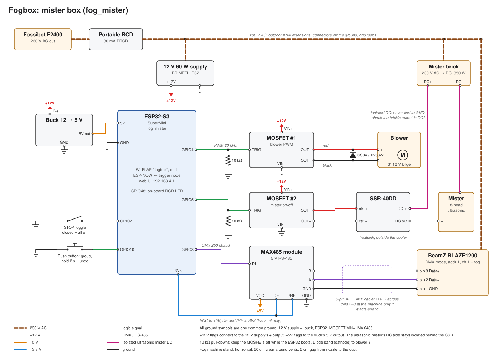
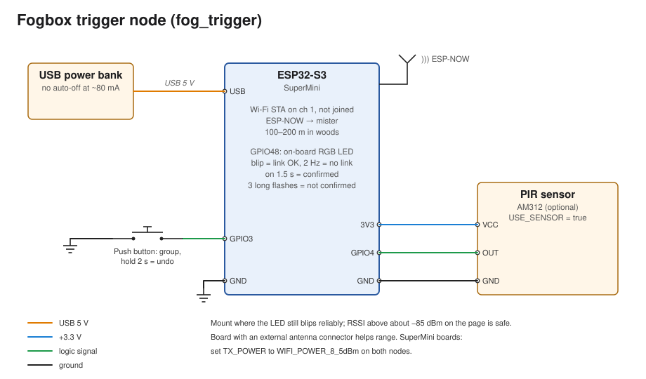

# fog-mister

Firmware for the **fogbox**: a chilled low-fog box hidden along a wooded path
that lays a 10–20 m layer of ground fog for each group of walkers, timed to
start about 90 seconds before they arrive.

Two boards: the **mister** box at the fog stretch and a **trigger** node
100–200 m upstream. The trigger tells the mister box a group is coming; the
mister box then runs a fog machine, an ultrasonic mister and a blower on a
timed cycle; the cold fog leaves the box at floor level into a perforated pipe
along the path edge.

```
  trigger node  ──ESP-NOW──►  mister box ──DMX──► fog machine       ─┐
  (button / PIR)              (ESP32-S3)  ──SSR──► ultrasonic mister ├─► chiller box ─► manifold pipe
                                          ──PWM──► blower            ─┘
                                 ▲
                         phone: Wi-Fi "fogbox", http://192.168.4.1
```

## Contents

| Path | What it is |
| --- | --- |
| [`fog_mister/`](fog_mister/main.cpp) | Mister box sketch: fog machine, ultrasonic mister, blower, web UI, cycle timing |
| [`fog_trigger/`](fog_trigger/main.cpp) | Trigger node sketch: button / PIR → ESP-NOW "group coming" |
| [`docs/fog_mister.svg`](docs/fog_mister.svg) | Mister box wiring schematic |
| [`docs/fog_trigger.svg`](docs/fog_trigger.svg) | Trigger node wiring schematic |
| [`docs/gen_schematics.py`](docs/gen_schematics.py) | Generates both schematics |
| [`deploy.py`](deploy.py) | Build, flash and monitor the boards, found by MAC |
| [`boards.toml`](boards.toml) | The physical boards: MAC, chip, role |

The code of each sketch lives in its `main.cpp`; the `.ino` file is an empty
stub so the Arduino IDE doesn't generate prototypes.

The earlier AT-style BLE config firmware is kept on the
[`esp-at-ble-config`](../../tree/esp-at-ble-config) branch.

## Hardware

Both boards are ESP32-S3 SuperMini boards (the sketches also build for an
ESP32-C3 SuperMini). A board with an external antenna connector helps radio
range.

**Mister box**

- BeamZ BLAZE1200 fog machine, driven over DMX through a MAX485 (5 V)
  RS-485 module and a cut 3-pin XLR cable
- 8-head ultrasonic mister on its own DC brick, switched by an SSR-40DD
- 3" 12 V bilge blower (3.0 A), PWM through a dual-MOSFET module, 5 A 40 V
  Schottky flyback diode across it (e.g. SB540)
- 12 V 60 W supply, 12 → 5 V buck converter for the ESP32
- STOP toggle switch and a push button
- Mains via a portable 30 mA RCD from a Fossibot F2400

**Trigger node**

- ESP32-S3 SuperMini on a USB power bank (one that doesn't auto-switch-off at ~80 mA)
- Push button, optional AM312 PIR sensor

### Wiring



| Mister box pin | Goes to | Note |
| --- | --- | --- |
| GPIO3 | MAX485 DI | DMX out; VCC to 5 V, DE and /RE to 3V3, RO not connected |
| GPIO4 | MOSFET #1 TRIG | Blower PWM, 20 kHz; 220 Ω in series, 10 kΩ TRIG → GND |
| GPIO5 | MOSFET #2 TRIG | Ultrasonic mister via SSR; 220 Ω in series, 10 kΩ TRIG → GND |
| GPIO7 | STOP toggle → GND | Closed = everything off |
| GPIO10 | Push button → GND | Short = group coming, hold 2 s = undo |
| GPIO48 | On-board RGB LED | WS2812 on the S3 SuperMini, shown green (C3 build: GPIO8, active low) |
| 5V / GND | Buck converter | Buck input from the 12 V supply |

The SSR control input is driven with a full 12 V (ctrl + to MOSFET #2 OUT+, ctrl − to
MOSFET #2 OUT−), since 3.3 V is below its 4 V minimum. OUT+ must carry the 12 V
through the module: check continuity between VIN+ and OUT+ with the module unpowered. The mister brick's DC+ goes to the
SSR's DC in, the SSR's DC out goes to the ultrasonic mister's +, and the mister's −
returns to the brick's DC−. The mister's DC side is isolated behind the SSR and
never shares the 12 V ground. Check that the mister brick's output is DC before
using the DC-switching SSR-40DD.



| Trigger pin | Goes to | Note |
| --- | --- | --- |
| GPIO3 | Push button → GND | Short = group coming, hold 2 s = undo |
| GPIO0 | On-board BOOT button | Same as the push button once running (GPIO9 on a C3) |
| GPIO4 | PIR output | Optional, set `USE_SENSOR` to `true` |
| GPIO48 | On-board RGB LED | WS2812 on the S3 SuperMini, shown blue (C3 build: GPIO8, active low) |
| USB | Power bank | About 80 mA |

## Building and flashing

Requires the Espressif Arduino core 3.3.x.

**deploy.py** (Python 3.11+, `pyserial`, `arduino-cli`)

Boards are listed in [`boards.toml`](boards.toml) by MAC, chip and role
(`MISTER` builds `fog_mister/`, `TRIGGER` builds `fog_trigger/`). `deploy.py`
finds each board's serial port by its MAC (native-USB ESP32 boards report it as
the USB serial number), so it doesn't matter which `/dev/ttyACM*` is which.

```sh
python3 deploy.py update                           # install the ESP32 core (once)
python3 deploy.py list                             # plugged-in boards and which entry they are
python3 deploy.py identify /dev/ttyACM2            # MAC + chip of a new board, for boards.toml
python3 deploy.py build all                        # build into dist/<chip>/<sketch>/
python3 deploy.py deploy mister trigger --monitor  # build, flash, serial output
python3 deploy.py monitor all                      # serial output of both, prefixed with the name
```

If flashing fails with a timeout or `Protocol error` (a board stuck in a reset
loop, or a flaky USB link), hold **BOOT**, press **RESET**, release BOOT, and
flash with `--no-reset`: `python3 deploy.py flash mister --no-reset`.

To see a board's boot in detail, build with `--flags=-DBOOT_DEBUG` (mister
only): it waits 8 s after power-on, printing the reset reason, so there is time
to open the serial port, then logs each init step.

A board name, a role (any case) or `all` selects boards; a role with a spare
flashes whichever of them is plugged in. The trigger is built with the mister
box's MAC, so rebuild it after replacing the mister board. Flashing writes the
bootloader, partition table (`no_ota`), `boot_app0` and app, never the NVS
partition, so the mister box keeps its settings. `DEBUG=1` adds `-DDEBUG`,
`--flags` / `EXTRA_FLAGS` add compiler flags, and `ARDUINO_DIRECTORIES_DATA`
picks the Arduino data directory (default `./.arduino15` if present, else
arduino-cli's own).

**Arduino IDE 2**

1. Boards Manager → install "esp32 by Espressif Systems" 3.x.
2. Board: "ESP32S3 Dev Module", Tools → USB CDC On Boot: Enabled,
   Partition Scheme: No OTA.
3. Open the `fog_mister` folder and upload; repeat for `fog_trigger` on
   the second board.

### Compile-time options

| Sketch | Define | Default | Meaning |
| --- | --- | --- | --- |
| both | `TX_POWER` | `WIFI_POWER_19_5dBm` | Cheap "SuperMini" boards often reach further at `WIFI_POWER_8_5dBm` |
| both | `ESPNOW_CHANNEL` | `1` | Must match on both boards |
| both | `LED_ACTIVE_LOW` | `1` | Set to `0` for an active-high LED |
| trigger | `USE_SENSOR` | `false` | Use the PIR on GPIO4 |
| trigger | `PIR_LOCKOUT_MS` | `45000` | One group per PIR trigger |
| mister | `AP_SSID` / `AP_PASS` | `fogbox` / `boo-fog-2026` | Web UI access point |

## Using it

Join Wi-Fi **fogbox** (password `boo-fog-2026`) and open
**http://192.168.4.1**. The page shows the phase, queued groups, next arrival,
fog / ultrasonic mister / blower state, warm-up countdown, fallback status, the trigger
node's signal strength and run time totals.

Buttons: *Group coming*, *Undo last group*, *Clear all groups*, *Fog burst
5 s*, *Mister 15 s*, *Blower test* (at a chosen %, 10 s), *End show* and
*STOP / Resume*.

### The cycle

Every trigger means "a group reaches the fog in *walk time* seconds". Groups
are queued, so overlapping cycles just work; the busiest phase of all queued
groups wins.

| Phase | Starts | Fog machine | Ultrasonic mister | Blower |
| --- | --- | --- | --- | --- |
| Build-up | 90 s before arrival | 8 s burst, then 5 s every 20 s | on | 45 % |
| Hold | at arrival, 90 s | 5 s every 30 s | on | 35 % |
| Tail | 30 s | off | on | 30 % |
| Purge | 60 s | off | off | 15 % |
| Idle | until the next group | heater stays hot | off | off |

**Safety limits:** no burst longer than 15 s, at least 10 s between bursts,
no fog during the first 4 minutes after power-on (warm-up), the blower ramps up
at 40 % per second, and STOP (switch or web) cuts everything at once.

**Fallback:** if no trigger arrives within the fallback interval (390 s) after
the last one, the mister starts a cycle itself. After 3 fallback cycles in
a row without a real trigger it stops, so it won't fog an empty wood after
the last group. *End show* disarms it straight away.

### Settings

Stored in NVS on the mister, editable on the web page, kept across
power-off.

| Setting | Default | Set it to |
| --- | --- | --- |
| Walk time | 120 s | A slow walk from the trigger point to the fog stretch |
| Fallback interval | 390 s | Group interval + 30 s (0 = off) |
| Build-up / hold / tail / purge | 90 / 90 / 30 / 60 s | Lengthen build-up if the layer isn't there in time |
| Blower % per phase | 45 / 35 / 30 / 15 | Lowest that still pushes fog to the pipe ends |
| Fog machine enabled | 1 | 0 for ultrasonic-mister-only mode before dusk |

On the fog machine: DMX mode, start address 1 (channel 1 = fog).

### LEDs

| Board | Pattern | Meaning |
| --- | --- | --- |
| Mister box | short blip every 2 s | idle |
| Mister box | fast blink | cycle running |
| Mister box | solid | stopped |
| Trigger | short blip every 2 s | link to mister OK |
| Trigger | blinking twice a second | no link |
| Trigger | flicker | sending |
| Trigger | on for 1.5 s | mister confirmed |
| Trigger | three long flashes | not confirmed |

## Radio protocol

The mister runs the `fogbox` access point on channel 1 and listens for
ESP-NOW on the same radio. The trigger node stays in station mode on channel 1
without joining the network.

Messages are a 6-byte packed struct: magic `0x464F4731` ("FOG1"), a type and a
sequence number. Types: `PING` (1), `GROUP` (2), `UNDO` (3); the mister
answers each with the same type OR'ed with `ACK` (0x80) and the same sequence
number.

- The trigger pings every 2 s; the link is OK while acks keep arriving.
- Built by `deploy.py`, the trigger knows the mister box's MAC from `boards.toml`
  (`-DMISTER_MAC`, its soft-AP MAC: on the S3 the base MAC with the locally
  administered bit set, `9c:…` → `9e:…`; on the C3 base + 1) and unicasts from boot,
  ignoring acks from any other board. Built without it, it broadcasts until
  the first ack, then unicasts to that board.
- `GROUP` and `UNDO` are resent every 250 ms, up to 8 times, until acked.
- The mister acts on each `GROUP` / `UNDO` sequence number once, so
  retries never queue a group twice.

## Test day

Before the event, at the real spot and ideally at dusk, measure the numbers
that can only be estimated on paper:

1. **Radio range:** walk the trigger node out until its LED stops blipping;
   RSSI above about −85 dBm on the page is safe.
2. **Walk time:** time a slow walk from the trigger point to the fog stretch.
3. **Idle draw:** let the fog machine heat up and idle for 10 minutes and read
   the average watts on the power station; this decides the power plan.
4. **One full cycle:** check when the layer appears, how far along the pipe it
   reaches and how long it lasts, then tune the blower percentages and the
   build-up time.

## License

Public domain, see [LICENSE](LICENSE).
